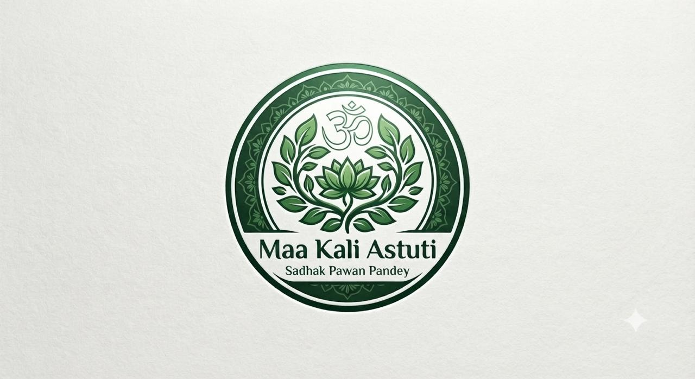
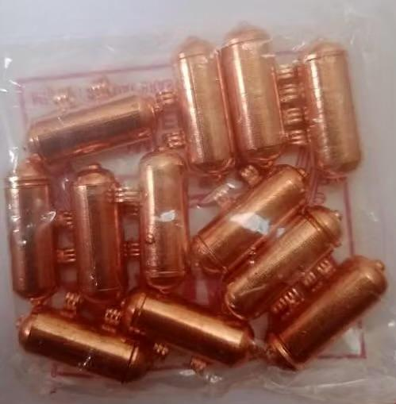

# Client Requirements & Project Blueprint: Maa Kali Astuti

---

## 1. Project Overview & Client Details

| Parameter | Details |
| :--- | :--- |
| **Brand Name** | **Maa Kali Astuti** (Spelling confirmed: Maa kali Astuti) |
| **Founder / Spiritual Guide** | **Sadhak Pawan Pandey** |
| **Domain Name** | `sadhakpawanpandey.com` |
| **Project Type** | Astrologer Website with E-Commerce on Home Page |
| **Key Functionalities** | E-commerce Store, Admin Panel, Payment Gateway, Bilingual (English & Hindi) |
| **Deployment Target** | **Vercel** (Smooth hosting & performance optimized) |
| **Reference Website** | [https://pages.jyotishbhawanindia.com/](https://pages.jyotishbhawanindia.com/) |

---

## 2. Core Creative, Animation & Experience Requirements (High Priority)

> **Client Objective & Direct Words:**  
> *"Astrologer wali website mein kuch unique chizey use krna jaisey animated real pandit ji jo ankh wagearh blink krey and rudraksh ki mala aisa kuch thoda unique qki hum yeahi website dikha kr client laa sktey h. And smooth ho website, thodey animation bhi ho, aisey slider mein yeah chakar hota hai wo rotation hota rhey, and smooth ho vercel pe host krna."*

1. **Unique Animated Visuals / Character (Pandit Ji Animation)**:
   - Unique showpiece element: Animated realistic Pandit Ji figure with interactive micro-animations (e.g., natural eye blinking, subtle movement, holding/rotating Rudraksha Mala).
   - High-impact visual anchor jo prospective clients ko impress kar sake.
2. **Rotating Sacred Chakra / Vedic Wheel Animations**:
   - Continuous smooth rotating Sacred Chakra / Jyotish wheel (slider, hero banner ya background elements mein continuous rotating effect).
   - Sacred geometry, aura glow, and subtle cosmic animations.
3. **Site Smoothness & Fluid UI**:
   - Super smooth interactions, lag-free transitions, fluid scrolling.
   - Lightweight, optimized components for instant response.
4. **Hosting & Deployment Target**:
   - **Vercel** par host karna hai (Vercel-compatible stack, fast edge CDN delivery).

---

## 3. Brand Visual Identity & Assets

### Logo
- **File Location**: `./images/maa-kali-astuti-logo.png`
- **Visual Description**: Sacred circular emblem featuring Vedic green mandala border, central sacred Lotus, lush green leaves, and the divine 'ॐ' (Om) symbol with text:
  - *Maa Kali Astuti*
  - *Sadhak Pawan Pandey*

### Product Sample Image (Tabiz / Copper Nag Set)
- **File Location**: `./images/handmade-copper-tabiz.png` / `./images/hand-energized-pure-copper-12-nag-set.png`
- **Visual Description**: Hand-energized copper tabeez / copper cylinders used for Bhojpatra amulets and sacred 12 Nag sets.

---

## 4. About Me: Sadhak Pawan Pandey

> **"Welcome to a space where ancient spiritual wisdom meets modern clarity."**

I am **Sadhak Pawan Pandey**, the founder and guiding force behind **Maa Kali Astuti**—my own dedicated platform and brand created to bridge the profound gap between traditional spiritual science and contemporary well-being.

### Personal Background & Philosophy
- **Corporate & Academic Background**: Holds an MBA with extensive corporate experience in multinational companies (MNCs). Chose to step beyond corporate corridors to dedicate life to cosmic energy, sacred rituals, mantra alignment, and paranormal research under enlightened mentors.
- **Scientific & Non-Superstitious Approach**: At Maa Kali Astuti, superstition is firmly rejected. Spirituality is established as an absolute, time-tested supreme science. Under proper guidance, conscious application of mantras and inner energy transforms life and resilience.
- **Published Author**: Published works reflecting authentic experiences and truths of the spiritual path.

### Core Areas of Offerings:
1. **Sadhana & Spiritual Mentorship**: Sadhana as an absolute science. Training seekers through authentic spiritual disciplines to lead spiritually aligned lives.
2. **Expert Consultations & Ritual Services**: Kundli analysis, Tarot Card reading, Palmistry, and customized spiritual pujas & anushthanas to mitigate life obstacles.
3. **Authentic Spiritual Offerings**: High-vibrational, authentic sacred products curated under the *Maa Kali Astuti* banner.

---

## 5. E-Commerce Products Catalog (Home Page Shop)

*Total 5 Main Product Categories / Offerings:*

### Category 1: Rudraksha and Malas
- **Original Nepali Rudraksha Beads**: All Mukhi beads from Two Mukhi (2 Mukhi) up to Fourteen Mukhi (14 Mukhi).
- **Five Mukhi (5 Mukhi) Rudraksha Mala**: Original Nepali.
- **Seven Mukhi (7 Mukhi) Rudraksha Mala**: Original Nepali.

### Category 2: Crystal Bracelets
Curated high-vibrational gemstone & crystal bracelets:
1. Pyrite Bracelet (Wealth & Abundance)
2. Citrine Bracelet (Success & Joy)
3. Green Jade Bracelet (Prosperity & Harmony)
4. Black Tourmaline Bracelet (Negative Energy Protection)
5. Tiger Eye Bracelet (Courage & Focus)
6. Rose Quartz Bracelet (Love & Relationships)
7. Amethyst Bracelet (Intuition & Peace)
8. Seven Chakra Bracelet (Chakra Balancing)
9. Clear Quartz Bracelet (Master Healer & Clarity)
10. Lapis Lazuli Bracelet (Wisdom & Truth)
11. Moonstone Bracelet (Emotional Balance & Intuition)
12. Garnet Bracelet (Passion & Energy)
13. Bloodstone Bracelet (Vitality & Strength)
14. Red Jasper Bracelet (Grounding & Stability)
15. Malachite Bracelet (Transformation & Protection)

### Category 3: Sacred Amulets (Handmade on Bhojpatra)
*Handmade on authentic Bhojpatra and ritually energized at an auspicious time (Muhurat) during powerful Mahapuja.*
- **Enclosure**: Encased in consecrated copper tabiz (Amulet capsule).
- **Available Amulets**:
  1. Maa Baglamukhi Amulet (Victory & Protection)
  2. Hanuman Amulet (Courage & Sankat Mochan)
  3. Durga Amulet (Universal Divine Shield)
  4. Mahakali Amulet (Destroyer of Negativity & Dark Forces)
  5. Mahavidya Amulet (Supreme Occult Knowledge & Power)
  6. Bhairav Amulet (Fearlessness & Fierce Protection)
  7. Child Evil Eye Protection Amulet (Balamukhi / Buri Nazar Kavach)

### Category 4: Bitter Havan Packet
- **Product Title**: Bitter Havan Packet – 100 grams
- **Purpose**: Specifically crafted to ward off deep negativity, evil eye, and stagnant energies immediately upon burning in the house / premises.

### Category 5: Hand-Energized Pure Copper 12 Nag (Twelve Serpents Set)
- **Product Title**: Hand-Energized Pure Copper 12 Nag (Twelve Serpents Set) – For Wealth, Protection & Success
- **Product Description**:
  Bring home the divine blessings and powerful protective energies of the Hand-Energized Pure Copper 12 Nag (Set of 12 Small Serpents). Skillfully crafted from high-quality copper and personally energized through powerful traditional rituals, this sacred set is designed to channel positive energies into your living space.
- **Key Traditional Benefits**:
  - **Attracts Wealth & Prosperity**: Invites financial growth, abundance, and endless prosperity into your life and business.
  - **Protection & Victory Over Enemies**: Acts as a powerful shield against negative energies, evil eye, and hidden adversaries, ensuring victory over competitors.
  - **Success in Legal Matters**: Believed to support favorable outcomes in ongoing court cases and legal litigations.
  - **Health & Healing**: Traditionally associated with providing relief from chronic diseases and promoting overall well-being and vitality.
- **Specifications & Features**:
  - **Material**: 100% Pure Copper
  - **Quantity**: Set of 12 Small Energized Nagas
  - **Energization**: Hand-energized and ritually consecrated for maximum spiritual benefit.
  - **Ideal For**: Home temples, lockers (Tijori), offices, or as a powerful Vastu remedy.

---

## 6. Astrology & Consultation Services

### 1. Kundali (Horoscope) Reading (with Satisfaction Guarantee)
- **Details**: Deep, soul-level analysis of birth chart covering career, marriage, finance, health, and hidden obstacles. Predictions accompanied by continuous guidance until doubts are resolved. Satisfaction guarantee included.

### 2. Palmistry (Hastrekha Shastra)
- **Details**: Submission of clear palm photographs to decode life lines, destiny, hidden traits, and critical life turning points using authentic Hastrekha principles.

### 3. Tarot Card Reading
- **Details**: Intuitive tarot spreads providing instant clarity, divine direction, and solutions for relationship dilemmas and complex personal situations.

### 4. Numerology (Ank Jyotish)
- **Details**: Aligning personal life path, mobile numbers, and business/brand names with auspicious vibrations using the science of numbers.

---

## 7. Sacred Sadhana Courses (Learn Ancient Occult Arts)

- **Course Fee**: **₹50,000** (साधना कोर्स की फीस 50,000)
- **Overview**:
  "Unlock the hidden secrets of the universe and learn direct, powerful spiritual paths under expert, battle-tested guidance. These are not just courses; they are life-altering traditional sadhanas designed to awaken your inner power, manifest desires, and protect yourself."
- **Available Specialized Sadhana Courses**:
  1. **Baglamukhi Sadhana**: Master the supreme power of protection, victory over enemies, and overcoming legal/life obstacles.
  2. **Hanuman Sadhana**: Awaken immense inner strength, courage, and fierce spiritual protection from negative energies.
  3. **Kali Sadhana**: Experience the intense, transformative, and wish-fulfilling grace of Maa Kali.
  4. **Durga Sadhana**: Attain absolute shields of protection, peace, prosperity, and unstoppable energy.
  5. **Shiva Sadhana**: Connect with the ultimate cosmic consciousness for profound peace, inner mastery, and spiritual evolution.
  6. **Bhairav Sadhana**: Command fierce protective energies and dissolve deep-seated fear and obstacles.
- **Enrollment Note**: Enrollment open for serious seekers. Course syllabus and admission process provided upon direct inquiry.

---

## 8. Specialized Spiritual Rituals & Anushthan (विशेष पूजा और अनुष्ठान)

- **Customized Ritual Services**: Deep, rigorous occult rituals and sacred anushthans customized to resolve severe life obstacles and fulfill sincere desires.
- **Strict Evaluation & Ethics**: Every case is spiritually analyzed first. Engagements are accepted only when there is confidence in the path forward.

---

## 9. Technical & Architectural Requirements

1. **E-Commerce Home Page**:
   - Modern, high-conversion landing page.
   - Featured products catalog with product descriptions, photos, and direct ordering / checkout capability.
2. **Language Toggle (Bilingual: English & Hindi)**:
   - Client requirement: *Google Translate / Language Toggle विकल्प ताकि कोई भी आसानी से समझ सके। दोनों languages (English + Hindi) में उपलब्ध होना चाहिए।*
3. **Payment Gateway Integration**:
   - Online payment processing (UPI, Cards, Netbanking, Wallets).
4. **Admin Panel**:
   - Product management (Add/Edit/Delete products, prices, stock).
   - Order management (View orders, customer info, payment status).
   - Inquiries & Consultations booking manager (Kundali, Palmistry, Tarot, Sadhana enrollments).
5. **Theme & Branding Aesthetics**:
   - Sacred Vedic Emerald Green (`#164e3f` / `#1c6b54`), Warm Antique Gold, Sacred Cream/White matching the official **Maa Kali Astuti** logo.
   - Maintain color consistency without deviating from client brand guidelines.

---

## 10. Latest Client Feedback & New Requirements (From Direct Client WhatsApp Chat)

### 10.1 Verbatim Chat Transcript & Timestamps

> **Client Chat Log (Exact Messages):**
> - **[7:49 AM]**: *"yeah wali far better thi"* (Referring to the clean approved visual layout shown in Image 1 / `maa-kali-astuti-homepage-final-design.png`)
> - **[7:50 AM]**: *"and jo refrence dia tha"*
> - **[7:50 AM]**: *"youtube video dalney ka bhi option chahiye"*
> - **[7:52 AM]**: *"Love Calculator by Name"*
> - **[7:52 AM]**: *"download your kundali in 99 rupess"*
> - **[8:03 AM]**: **Reference URL 1**: `https://demo.kamleshyadav.com/themeforest-html/astrology/version-5/index.html`
>   *(Astrology — Where ancient cosmic wisdom meets modern spiritual discovery. Horoscopes, birth charts, tarot, and personal astrology readings.)*
> - **[8:03 AM]**: *"ismey ek rashifal wala section round ghumm rha hai"*
> - **[8:04 AM]**: *"automatic show ho rha hai"*
> - **[8:04 AM]**: *"and necey ek love calculator ek kundali wala"*
> - **[8:06 AM]**: **Reference URL 2**: `https://astrology.nicdark.com/astrology-wordpress-theme/home-03/`
> - **[8:07 AM]**: *"ismey kuch animation dekhna jaisey footer mein ya kuch stones bhi hai"*
> - **[8:07 AM]**: *"jisese site heavy na ho waisi"*

---

### 10.2 Primary Reference URLs Analyzed

1. **Reference 1: Kamlesh Yadav Astrology HTML Demo (Version 5)**
   - **URL**: [https://demo.kamleshyadav.com/themeforest-html/astrology/version-5/index.html](https://demo.kamleshyadav.com/themeforest-html/astrology/version-5/index.html)
   - **Key Features Noted by Client**:
     - **Rotating Rashifal (Zodiac Wheel) Section**: Ek circular zodiac wheel jo continuously round ghoomta hai aur automatically rashifal switch/show karta hai.
     - **Love Calculator**: Name-based compatibility tool.
     - **Kundali Generator / Downloader**: Interactive birth chart input.

2. **Reference 2: Nicdark Astrology WordPress Theme (Home 03)**
   - **URL**: [https://astrology.nicdark.com/astrology-wordpress-theme/home-03/](https://astrology.nicdark.com/astrology-wordpress-theme/home-03/)
   - **Key Features Noted by Client**:
     - **Lightweight Floating Gemstone / Crystal Animations**: Floating healing stones (pyrite, amethyst, quartz, rudraksha) with smooth CSS floating motion.
     - **Footer Cosmic Animations**: Subtle twinkling stars / sacred mandala accents that maintain ultra-fast performance without making the site heavy.

---

### 10.3 New Features Breakdown & Specification

#### 1. Layout Restructure (Revert to Approved Reference - Image 1)
- **Client Direction**: *"yeah wali far better thi"*
- **Action**: Replace the current experimental full-bleed hero layout with the clean, balanced, magazine-style layout shown in Image 1:
  - Clean top bar + header with search & language switch.
  - Altar table hero composition: Rudraksha mala, crystal quartz, brass deepam with flame, sacred books "Sadhana & Siddhi", sacred tulsi leaves, and peace shloka `|| सर्वे भवन्तु सुखिनः || May all be happy`.
  - 5 circular product category cards (*Rudraksha & Malas, Crystal Bracelets, Handmade Amulets, Bitter Havan Packet, Energized Copper Offerings*).
  - Featured Product card (*Hand-Energized Pure Copper 12 Nag* with badges, ₹1,250 price, quantity selector, and "Small Objects Big Blessings" side note).
  - 4 Personal Guidance consultation cards (*Kundali, Palmistry, Tarot, Numerology*).
  - Sacred Sadhana Courses section with fee `₹50,000` and 6 course cards.
  - Specialized Rituals & Anushthan with sacred thali / diya visual.
  - About Sadhak Pawan Pandey with quote card and bio.
  - Testimonials & FAQs grid.
  - Full Vedic footer with email newsletter signup.

#### 2. YouTube Video Integration Section
- **Client Direction**: *"youtube video dalney ka bhi option chahiye"*
- **Specification**: A dedicated sacred video showcase section for Sadhak Pawan Pandey's discourses, rituals, and guidance:
  - Featured responsive video player (embed container for YouTube).
  - Video title, description, and thumbnail carousel for multiple video talks / pravachans.
  - Option to easily paste / update YouTube video URLs via standard iframe embed.

#### 3. Love Calculator by Name
- **Client Direction**: *"Love Calculator by Name"*
- **Specification**: An interactive astrology engagement tool:
  - Input fields: *Your Name* and *Partner's Name*.
  - Zodiac / Numerological vibration algorithm calculating love compatibility score (percentage).
  - Astrological harmony insight and direct CTA: *"Book a Personal Kundali Match Consultation"* to get deep compatibility analysis from Sadhak Ji.

#### 4. Download Your Kundali in ₹99
- **Client Direction**: *"download your kundali in 99 rupess"*
- **Specification**: A high-converting lead magnet & low-ticket offering banner/card:
  - Title: **Download Your Complete Janam Kundali in ₹99**
  - Instant birth chart calculation: Inputs for Name, Date of Birth, Time of Birth, Place of Birth.
  - Generates a preview with planetary positions, lagna chart, and instant download/payment trigger for the full 25+ page detailed horoscope report for just ₹99.

#### 5. Rotating Rashifal (Zodiac Wheel) Section (Auto-Cycling)
- **Client Direction**: *"ismey ek rashifal wala section round ghumm rha hai automatic show ho rha hai"*
- **Specification**:
  - Interactive circular 12 Rashi wheel that continuously rotates slowly.
  - Automatically highlights each Rashi in sequence, or allows users to click on any Rashi (Mesha to Meena).
  - Displays daily/monthly Rashifal forecast with lucky numbers, lucky colors, and remedies.

#### 6. Lightweight Cosmic & Gemstone Floating Animations
- **Client Direction**: *"ismey kuch animation dekhna jaisey footer mein ya kuch stones bhi hai jisese site heavy na ho waisi"*
- **Specification**:
  - Pure CSS hardware-accelerated micro-animations (`transform: translate3d`).
  - Subtle floating gemstone accents (healing crystals, rudraksha beads) in relevant product/horoscope sections.
  - Gentle twinkling sacred constellations in the footer background.
  - Zero heavy JavaScript libraries (maintains 90+ Lighthouse speed and Vercel edge delivery).

